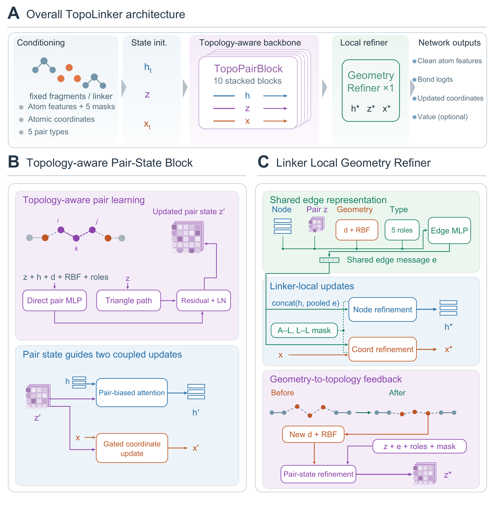

<div align="center">

# TopoLinker

**Topology-Aware Flow Matching for Structure-Constrained PROTAC Linker Generation**

*3D linker generation from fixed molecular fragments*

[Data](#data) · [Environment](#environment) · [Training](#training) · [Sampling](#sampling)

</div>

<p align="center">
  
</p>

---

## Data

The molecular data used for TopoLinker were collected from **[PROTAC-DB](https://cadd.zju.edu.cn/protacdb/downloads)**. Dataset files are not included in this source repository.

### 1. Obtain the source data

Download the **PROTAC**, **linker**, and **E3-ligand** tables from PROTAC-DB. The preprocessing scripts expect CSV files with the following names:

```
datasets/
├── protac.csv
├── linker.csv
└── e3_ligand.csv
```

The current PROTAC-DB website may provide Excel/SDF downloads rather than the CSV format used by these scripts. Export the corresponding tables as CSV **without changing the required column names** (see `data/process_data.py`). Database updates may change the available compounds and therefore the resulting splits.

### 2. Preprocess the molecules

Run the following commands **from the repository root**, after preparing the source CSV files:

```
python -m data.process_data
python -m data.train_val_test
python -m data.prepare_reference_linkers
```

These steps perform PROTAC fragmentation, linker-cluster-based train/validation/test splitting, 3D conformer generation, and preparation of the molecular SDF/CSV files. They also create `datasets/reference_linkers.smi`.

The pretraining loader (`data/datasets.py`) automatically builds `protac_pretrain_train.pt` and `protac_pretrain_val.pt` from the processed molecular files if the `.pt` files do not yet exist.

### 3. Prepare RL data

RL training uses the processed molecular records together with the inputs required by **PROTAC-STAN** and **DeepTernary**. Prepare the following files from the processed RL splits:

1. **Protein sequences.** Collect the POI and E3 UniProt identifiers (`Uniprot` and `e3_ligase_Uniprot`) from `datasets/rl/{train,val,test}/protac_processed.csv`. Retrieve the corresponding UniProt FASTA sequences and save the mapping to `datasets/rl/p_map.pkl`. The sequence-retrieval implementation is in `data/protein_emb.py`.
2. **Protein embeddings.** Use the pretrained **ESM-2-650M-S** model, following the protein-encoding approach used by PROTAC-STAN, to calculate embeddings for the proteins in `p_map.pkl`. Save the independently generated representations as `datasets/rl/esm_s_map.pkl`. The embedding script is `data/get_embed_s.py`.
3. **Molecular descriptor statistics.** Compute the mean and standard deviation of the nine molecular descriptors in `datasets/rl/train/protac_processed.csv` (training split only), and store them as `datasets/rl/descriptor_stats.pkl` with `mean` and `std` dictionaries. These statistics are used by the PROTAC-STAN reward adapter in `model/reward_models.py`.
4. **DeepTernary inputs and RL tensors.** Use `build_deepternary_rl2_protac_unbound_aligned_v4_fixed.py` and `prepare_deepternary_inputs.py` to prepare and associate the available experimental protein–ligand structures. The data-building script `data/prepaer_final_data.py` constructs the `protac_rltrain_{train,val,test}.pt` files from the prepared RL records and structure mappings.

After preparing `datasets/rl/{train,val,test}/protac_processed.csv`, retrieve the UniProt sequences and create `datasets/rl/p_map.pkl`:

```
python -m data.protein_emb
```

Then, with the pretrained ESM-S checkpoint available at `./model/esm_650m_s.pth`, generate `datasets/rl/esm_s_map.pkl`:

```
python -m data.get_embed_s --root ./datasets/rl
```

The embedding step requires **TorchDrug, CUDA, and the pretrained ESM-S checkpoint**; the external model weights and DeepTernary structures are not included in this repository. The data-preparation scripts implement separate processing stages rather than one end-to-end command.

Training and sampling expect the processed files under `./datasets/`. Reproducing the exact study splits requires the same source-data snapshot and preprocessing settings; a newer PROTAC-DB download may lead to different splits.

## Environment

A Conda environment specification is provided for Python 3.10 and the PyTorch/CUDA 11.8 stack:

```
git clone https://github.com/ghqwgqtw-bot/TopoLinker.git
cd TopoLinker
conda env create -f environment.yml
conda activate topolinker
```

The environment was installation-tested on Linux. GPU training requires a compatible NVIDIA driver and CUDA-capable GPU. External reward models and their pretrained checkpoints are **not** bundled with TopoLinker.

## Training

Training comprises supervised pretraining followed by two reward-optimization stages. All commands below are run from the project root.

### 1. Supervised pretraining

```
python -m experiments.train
```

Configuration: `configs/base.yaml`. Checkpoints are saved under `checkpoints/experiment/<timestamp>/`.

### 2. RL Stage 1

```
python -m experiments.train_rl --config-name rl_flow_stage1
```

Configuration: `configs/rl_flow_stage1.yaml`. By default this stage loads `weights/base.pth` and uses **[PROTAC-STAN](https://github.com/PROTACs/PROTAC-STAN)** for degradation-related rewards.

### 3. RL Stage 2

```
python -m experiments.train_rl --config-name rl_flow_stage2
```

Configuration: `configs/rl_flow_stage2.yaml`. By default this stage loads `weights/rl_best.pth` and uses PROTAC-STAN together with **[DeepTernary](https://github.com/youqingxiaozhua/DeepTernary)**.

For training from scratch, update `experiment.weight_path` to the checkpoint selected from the preceding stage. The RL scripts save epoch checkpoints under `checkpoints/experiment_flow_stage1/` and `checkpoints/experiment_flow_stage2/`; the `weights/` filenames are the checkpoint paths configured for the released runs.

For DeepTernary, the project includes an adapted prediction script at `third_party_adaptations/predict.py`. If reproducing Stage 2, use that adaptation as the external DeepTernary project's `predict.py`, subject to the upstream project's license and setup instructions. The expected local external-project paths are specified in the two RL YAML files.

## Sampling

Pretrained TopoLinker model checkpoints are provided in `weights/`. The default sampling configuration is `configs/base_test.yaml`, which loads `weights/rl_best_final.pth`.

**Generate linkers without running external reward models:**

```
python -m experiments.protac_test \
  experiment.eval_mode=generate \
  experiment.use_protac_stan_reward=false \
  experiment.use_deepternary_reward=false
```

The script samples under the prepared **RL test-set fragment conditions**. It does not require protein information for generation. The default setting is five samples per test context (`experiment.test_num_samples=5`); override it if needed:

```
python -m experiments.protac_test \
  experiment.eval_mode=generate \
  experiment.use_protac_stan_reward=false \
  experiment.use_deepternary_reward=false \
  experiment.test_num_samples=10
```

Generated molecules and their metadata are saved to:

```
eval_outputs/test_rl_final/records.pkl
```

Each record contains a generated RDKit molecule (`pred_mol`) together with the associated fragment and sample information. A prepared `datasets/protac_rltrain_test.pt` is required; the present sampling entry point is **dataset-conditioned**, not a general two-SDF command-line interface.

The same entry point also supports `experiment.eval_mode=evaluate` and `experiment.eval_mode=both` for optional post-generation metrics. These modes may require the external reward models and auxiliary inputs configured in `configs/base_test.yaml`.
